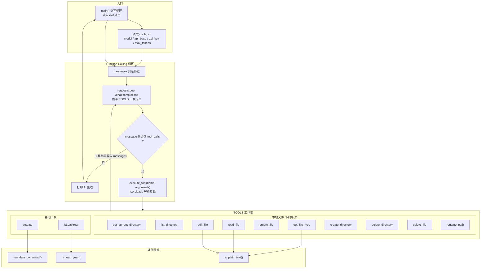

# practice02 — 本地工具调用（Function Calling）

基于 DeepSeek（OpenAI 兼容接口）的函数调用对话程序：让大模型通过 `tools` 定义，自主调用本地 Python 函数完成文件/目录操作、获取日期时间等。

## 文件说明

| 文件 | 说明 |
| --- | --- |
| `chat.py` | 基础版：`getdate`、`isLeapYear` 两个工具 |
| `tool.py` | 在 `chat.py` 基础上新增 10 个本地文件/目录操作工具（共 12 个） |
| `config.ini` | LLM 配置（model / api_base / api_key / max_tokens） |
| `architecture.mmd` | `tool.py` 的 Mermaid 架构图（纯文本） |

## 运行

```bash
pip install requests
cd agent/practice02
python tool.py
```

启动后输入问题，输入 `exit` 退出。`config.ini` 示例：

```ini
[llm]
model = deepseek-chat
api_base = https://api.deepseek.com/v1
api_key = YOUR_API_KEY_HERE
max_tokens = 512
```

## 工具列表

**基础工具**

| 工具 | 参数 | 说明 |
| --- | --- | --- |
| `getdate` | — | 调用本地 `date` 命令获取日期和时间 |
| `isLeapYear` | `year` | 用 Python 判断是否闰年 |

**本地文件 / 目录操作**

| 工具 | 参数 | 说明 |
| --- | --- | --- |
| `get_current_directory` | — | 获取当前工作目录 |
| `list_directory` | `path` | 列出目录下所有文件和子目录 |
| `get_file_type` | `path` | 获取文件类型（目录/纯文本/二进制，含扩展名与 MIME） |
| `read_file` | `path` | 读取纯文本文件内容 |
| `create_file` | `directory`, `file_name`, `content?` | 创建新文件 |
| `edit_file` | `path`, `content` | 覆盖编辑纯文本文件内容 |
| `create_directory` | `path` | 创建新目录（自动创建父目录） |
| `delete_directory` | `path` | 删除目录（含非空目录） |
| `delete_file` | `path` | 删除文件 |
| `rename_path` | `old_path`, `new_path` | 重命名文件或目录 |

> `read_file` / `edit_file` 通过 `is_plain_text()` 判断：无空字节且可用 UTF-8 解码，才视为纯文本，否则拒绝操作。

## 工作流程

1. `main()` 读取 `config.ini`，初始化 `messages`。
2. 用户输入追加到 `messages`，带上 `TOOLS` 请求 `/chat/completions`。
3. 若返回的 `message` 含 `tool_calls`，由 `execute_tool(name, arguments)` 解析参数并执行对应函数，结果以 `role: tool` 写回 `messages`，再次请求模型。
4. 直到模型不再请求工具，打印 AI 回答。

## 架构图


